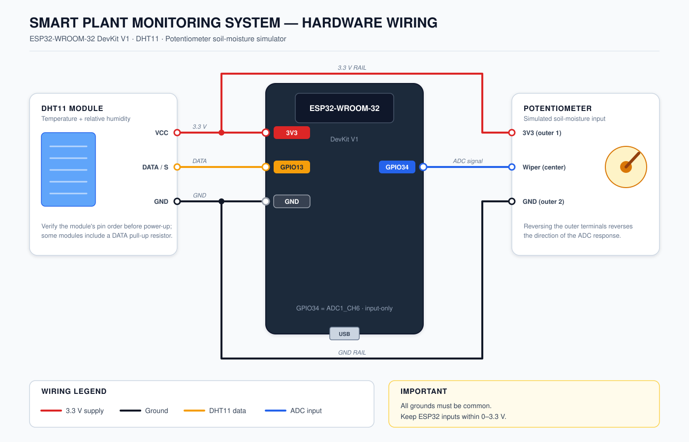
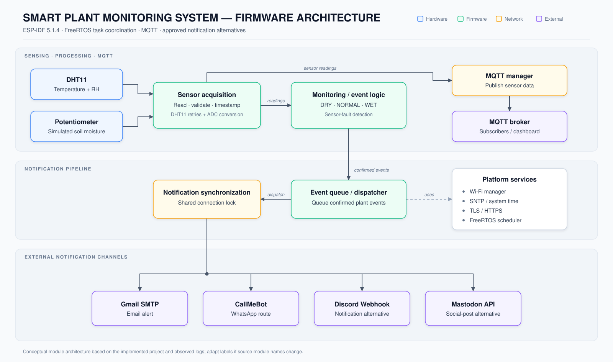
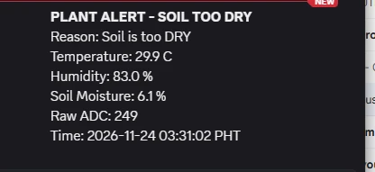
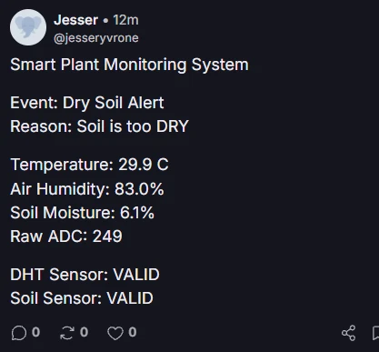
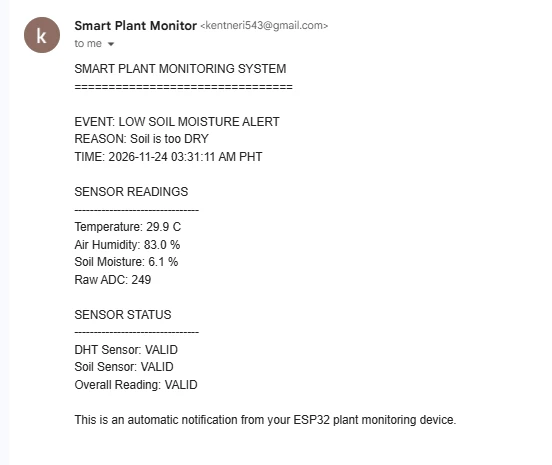
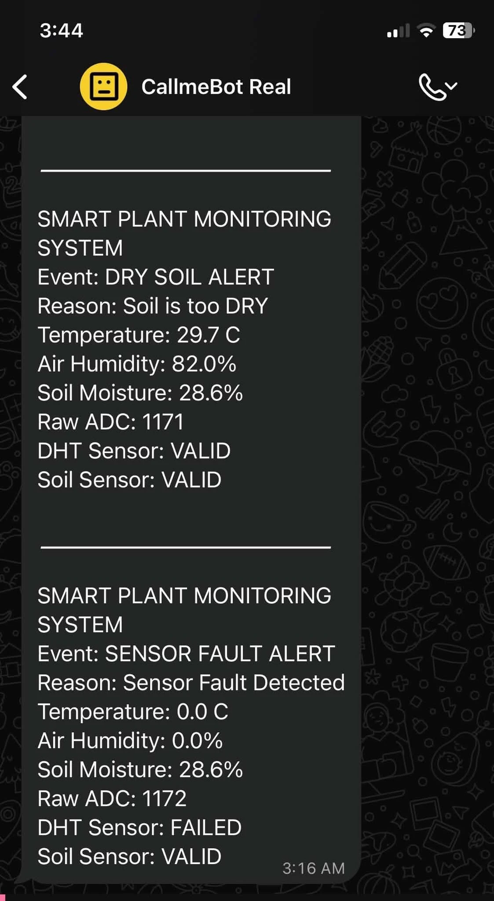

# Smart Plant Monitoring System

An ESP32 plant-condition monitor built on **ESP-IDF** and **FreeRTOS**. It samples air temperature, relative humidity and a soil-moisture input, classifies the plant's condition, publishes readings over **MQTT**, and sends event-driven alerts through **Gmail, WhatsApp, Discord and Mastodon**.

| | |
|---|---|
| **Course** | BCA152 Microcontrollers, Project No. 1 |
| **Institution** | Mindanao State University – Iligan Institute of Technology, College of Computer Studies |
| **Board** | ESP32-WROOM-32 DevKit V1 |
| **Framework** | ESP-IDF 5.1.4 (integrated FreeRTOS), built with PlatformIO |
| **Language** | C |
| **Author** | Jesser Neri, Section: B186 |

---

## Contents

1. [Features](#1-features)
2. [Deviations from the project brief](#2-deviations-from-the-project-brief)
3. [Hardware](#3-hardware)
4. [System architecture](#4-system-architecture)
5. [Plant-condition logic](#5-plant-condition-logic)
6. [Notification policy and channels](#6-notification-policy-and-channels)
7. [Security](#7-security)
8. [Repository structure](#8-repository-structure)
9. [Getting started](#9-getting-started)
10. [Demonstration procedure](#10-demonstration-procedure)
11. [Testing and results](#11-testing-and-results)
12. [Known limitations](#12-known-limitations)
13. [Third-party components](#13-third-party-components)

---

## 1. Features

- Periodic acquisition of temperature (°C), relative humidity (%RH) and a soil-moisture input (raw ADC value and moisture %).
- Validation of every reading. A failed sensor produces a **SENSOR FAULT** event and is never reported as a normal condition.
- Three-state classification (**DRY / NORMAL / WET**) with hysteresis and state confirmation.
- Concurrent firmware: sensing, monitoring and notification run as separate FreeRTOS tasks connected by queues, so a slow network call never blocks sensing.
- Automatic Wi-Fi reconnection and SNTP time synchronisation.
- Sensor data published to an MQTT broker.
- Alerts delivered to four independent channels, all of which are free to use.
- TLS with certificate verification for outbound connections; secrets kept out of version control.

## 2. Deviations from the project brief

The project brief specifies a DHT22, a capacitive soil sensor, and Gmail, WhatsApp, Telegram and X. The following substitutions were made. Paid or unavailable services were replaced with free equivalents that produce the same outcome (a delivered message or post carrying the same data).

| Brief requirement | Implemented | Reason |
|---|---|---|
| DHT22 | DHT11 | Available hardware. |
| Capacitive soil moisture sensor | Potentiometer on an ADC pin | Repeatable, controllable input for demonstrating conversion and classification logic. It is a **simulation**, not a soil measurement. |
| Telegram | Discord webhook | Free, one authenticated HTTPS request. |
| X (Twitter) | Mastodon | The X API has no free tier for new developers (pay-per-use since February 2026). |
| WhatsApp Cloud API | CallMeBot | Free relay to a personal WhatsApp account. |
| Gmail SMTP | Gmail SMTP (unchanged) | Uses a Google App Password. |


## 3. Hardware

| Component | Role | Interface |
|---|---|---|
| ESP32-WROOM-32 DevKit V1 | Controller, Wi-Fi, firmware | USB / Wi-Fi |
| DHT11 module | Temperature and relative humidity | Digital GPIO |
| Potentiometer | Adjustable soil-moisture input | Analog (ADC1) |
| Breadboard, jumper wires, USB data cable | Assembly and programming | – |

### Wiring



| ESP32 pin | Connects to | Purpose |
|---|---|---|
| 3V3 | DHT11 VCC | Sensor supply |
| GND | DHT11 GND | Common ground |
| GPIO13 | DHT11 DATA / S | Digital data |
| 3V3 | Potentiometer outer terminal 1 | Reference |
| GND | Potentiometer outer terminal 2 | Ground |
| GPIO34 (ADC1_CH6) | Potentiometer centre terminal (wiper) | Analog input |

Notes:
1. All grounds must be common, and all signals must stay within 0–3.3 V.
2. GPIO34 is input-only; never configure it as an output.
3. Swapping the potentiometer's outer terminals reverses the ADC response direction.
4. Some DHT11 modules include a DATA pull-up resistor. A bare sensor needs an external pull-up (see its datasheet). Verify the pin order printed on your module before powering it.

## 4. System architecture



### Components

| Component | Responsibility |
|---|---|
| `main` | Initialises services and starts tasks |
| `sensors` | Reads the DHT11 and the ADC; validates results |
| `monitoring` | Converts moisture, classifies state, generates events |
| `sensor_task` | Periodic sensing cycle; dispatches readings and events |
| `wifi_mgr` | Wi-Fi connection, reconnection, SNTP |
| `mqtt_mgr` | MQTT connection and publishing |
| `email_mgr` | Gmail SMTP notifications |
| `callmebot_mgr` | CallMeBot (WhatsApp) notifications |
| `discord_mgr` | Discord webhook notifications |
| `mastodon_mgr` | Mastodon status posts |
| `notification_sync` | Shared lock coordinating outbound notification sessions |
| `system_time` | System time support |

### FreeRTOS design

| Item | Value |
|---|---|
| Sensing period | Periodic sensor monitoring task; exact interval not verified in the current source. |
| Tasks, priorities and stack sizes | sensor_monitor_task: priority 5, stack 4096 bytes, Core 1. email_task: stack 16384 bytes. callmebot_task: stack 16384 bytes. Discord, Mastodon and MQTT task priorities and stack sizes: not verified. |
| Queues | CallMeBot notification queue: 5 messages. Notification messages contain is_test, plant_event_t and sensor_reading_t fields. Other queue names, item types and lengths: not verified. |
| Other synchronisation | FreeRTOS mutex initialized through notification_sync_init() and used by Gmail, CallMeBot, Discord and Mastodon to coordinate outbound network connections |
| Data ownership | Plant events and sensor readings are copied into notification queue message structures. The receiving notification task processes its own queued copy. |


## 5. Plant-condition logic

The system converts the potentiometer's raw ADC reading into a simulated soil-moisture percentage.

### Moisture conversion formula

```c
moisture_pct = clamp(
    (raw_dry - raw) * 100 / (raw_dry - raw_wet),
    0,
    100
);
```

### Configuration and thresholds

| Parameter | Value |
|---|---|
| `raw_dry` | 2800 ADC |
| `raw_wet` | 1200 ADC |
| Response direction | Higher raw ADC values indicate DRY conditions; lower raw ADC values indicate WET conditions. |
| DRY threshold | Moisture below 30% |
| NORMAL band | Moisture from 30% to 75% |
| WET threshold | Moisture above 75% |
| Hysteresis band | 5% |
| Confirmation | 3 consecutive valid readings before confirming a state change. |

### Sensor validation

The system validates sensor readings before using them for plant-condition classification.

- DHT11 readings are checked for successful acquisition.
- Temperature values are checked against the valid physical range of -40°C to 80°C.
- Relative humidity values are checked against the valid range of 0% to 100%.
- Soil ADC readings are checked against the configured valid range.
- Invalid sensor readings are flagged and produce a SENSOR FAULT event instead of being treated as normal readings.

### Hysteresis and state confirmation

Hysteresis prevents frequent switching between plant conditions when readings fluctuate near a threshold.

The system requires three consecutive valid readings before confirming a state change.

| Current state | Condition | Result |
|---|---|---|
| NORMAL | Moisture below 25% | DRY |
| NORMAL | Moisture above 80% | WET |
| DRY | Moisture above 35% | NORMAL |
| WET | Moisture below 70% | NORMAL |
| UNKNOWN or FAULT | Moisture below 30% | DRY candidate |
| UNKNOWN or FAULT | Moisture above 75% | WET candidate |

Invalid readings are classified as SENSOR FAULT.

**Note:** Soil moisture is simulated using a potentiometer. The displayed percentage is not a direct measurement of actual soil water content.


## 6. Notification policy and channels

The system generates notifications when a significant plant-condition event occurs. Notifications are processed separately from sensor monitoring using FreeRTOS tasks and queues.

### Event types

| Event | Trigger |
|---|---|
| Initial report | First valid reading after boot with the network available |
| DRY alert | Confirmed transition to DRY |
| WET alert | Confirmed transition to WET |
| SENSOR FAULT | Invalid or unavailable sensor reading |
| Recovery | Confirmed return to NORMAL |

### Notification cooldown

Repeated identical alerts are suppressed using a cooldown period of **15 minutes (900 seconds)**.

This prevents repeated notifications for the same condition while allowing sensor monitoring and MQTT publishing to continue.

Demo triggers can bypass the cooldown for demonstration purposes.

### Notification message contents

Each notification contains the following information:

- Event type and reason
- Temperature in degrees Celsius
- Relative humidity percentage
- Simulated soil-moisture percentage
- Raw ADC value
- Timestamp
- Sensor-validity information

### Notification channels

The project uses four notification channels:

| Channel | Mechanism | Success indicator |
|---|---|---|
| Gmail | SMTP over TLS using a Google App Password | Authentication accepted, message accepted, `Email sent successfully` |
| WhatsApp | CallMeBot HTTP request | HTTP 210 (request accepted) |
| Discord | Discord webhook | HTTP 204 |
| Mastodon | `POST /api/v1/statuses` | HTTP 200 |

### MQTT communication

Sensor readings are published to the configured MQTT broker.

The firmware logs the publishing process, including:

```text
Sensor readings queued for MQTT
Message acknowledged. ID=...
```

The MQTT broker address, port, credentials, and topic are configured through the project's local configuration.

### FreeRTOS notification handling

Notification tasks operate separately from the sensor-monitoring process.

This allows the ESP32 to continue monitoring sensor readings while external notification services process requests.

A shared synchronization mechanism coordinates outbound notification sessions across the notification channels.


## 7. Security

- **TLS-Protected Communication:** Outbound HTTPS and SMTP connections use TLS to protect data transmitted between the ESP32 and external services.
- **Certificate Verification:** Certificate verification is configured for outbound secure connections to help prevent unauthorized or untrusted server connections.
- **Credential Protection:** Wi-Fi credentials, Gmail App Password, CallMeBot API key, Discord webhook URL, Mastodon access token, and MQTT credentials are stored locally in `config.h`.
- **Git Protection:** The local `config.h` file is excluded from version control through `.gitignore`. A `config.example.h` file provides configuration placeholders without exposing actual credentials.
- **Error Handling:** Network errors and connection timeouts are handled to prevent uncontrolled request loops and repeated failed connection attempts.
- **Notification Security:** External notification services use their respective authentication credentials or webhook URLs when sending alerts.
- **Log Protection:** Serial logs and screenshots stored in `docs/results/` must not expose passwords, API keys, access tokens, webhook URLs, or other private credentials.

**Security considerations:**

- Never commit `config.h` or publish actual service credentials.
- Replace exposed credentials immediately if they are accidentally shared.
- Keep authentication tokens and webhook URLs private.
- Verify TLS certificate configuration when changing network or notification components.

---
## 8. Repository structure

```text
Smart-Plant-Monitoring/
├── README.md
├── platformio.ini
├── CMakeLists.txt
├── sdkconfig.defaults
├── dependencies.lock         # ESP-IDF component manager lock file
├── config.example.h          # placeholders only, no secrets
├── config.h                  # local credentials, git-ignored (not committed)
├── .gitignore
├── src/
├── components/
│   ├── sensors/
│   ├── monitoring/
│   ├── wifi_mgr/
│   ├── mqtt_mgr/
│   ├── email_mgr/
│   ├── callmebot_mgr/
│   ├── discord_mgr/
│   ├── mastodon_mgr/
│   └── notification_sync/
├── include/
├── lib/
├── test/                     # unit tests
└── docs/
    ├── architecture/         # wiring-diagram.svg, system-architecture.svg
    ├── results/              # redacted logs and screenshots
    └── technical-report.pdf
```

Generated or local files that are not part of the source tree: `.pio/` (PlatformIO build output), `.vscode/` (editor settings), `managed_components/` (downloaded by the ESP-IDF component manager) and `sdkconfig.esp32dev` (generated by the build from `sdkconfig.defaults`).

## 9. Getting started

### Requirements

- Visual Studio Code with the PlatformIO extension
- ESP-IDF 5.1.4 (installed by PlatformIO)
- ESP32-WROOM-32 DevKit V1 and a USB data cable
- A 2.4 GHz Wi-Fi network with Internet access
- Accounts for the services in [section 6](#6-notification-policy-and-channels)

`platformio.ini` selects ESP-IDF explicitly (`framework = espidf`); the Arduino framework is not used.

### Configure

1. In the project root, copy `config.example.h` to `config.h`.
2. Fill in the values below. Never commit this file.

| Setting | Where to get it |
|---|---|
| Wi-Fi SSID and password | Your network |
| MQTT broker, port, credentials | Your broker |
| Gmail address and **App Password** | Google Account → Security (requires 2-Step Verification) |
| CallMeBot API key and phone | Activate through the CallMeBot WhatsApp bot |
| Discord webhook URL | Channel → Integrations → Webhooks |
| Mastodon instance URL and access token | Preferences → Development → New application (scope `write:statuses`) |
| `raw_dry`, `raw_wet` | Calibration (section 5) |

### Build, flash, monitor

```powershell
pio run                              # build
pio run -t upload                    # flash
pio device monitor -p COM3 -b 115200 # replace COM3 with your port
```

## 10. Demonstration procedure

1. Connect the board and open the serial monitor; confirm clean boot, Wi-Fi connection and time sync.
2. Confirm MQTT connects and readings are published.
3. Confirm DHT11 temperature and humidity are plausible.
4. Turn the potentiometer and watch the moisture percentage and state change.
5. Drive the input below 30 % and confirm a DRY alert in the log (`EVENT GENERATED: Type=2, Reason=Soil is too DRY`).
6. Verify the alert arrived on Gmail, WhatsApp, Discord and Mastodon.
7. Disconnect the DHT11 data wire and confirm a SENSOR FAULT alert distinct from a moisture alert.
8. Return the input to the NORMAL band and confirm the recovery notification.

## 11. Testing and results

### Testing Results and Evidence

The system's operation and notification outputs were documented through screenshots and photos. These provide visual evidence of sensor readings, plant condition alerts, sensor fault notifications, and successful message delivery through the configured notification channels.

The collected testing evidence is available in `docs/results/`.

```text
EVENT GENERATED: Type=2, Reason=Soil is too DRY
PLANT EVENT: Type=2 | Moisture=6.1%
```

### Delivery evidence

| Channel | Screenshot |
|---|---|
| Discord | `docs/results/01_discord_dry_alert.webp` |
| Mastodon | `docs/results/02_mastodon_dry_alert.webp` |
| Gmail | `docs/results/03_gmail_dry_alert.webp` |
| WhatsApp (CallMeBot), including a sensor-fault message | `docs/results/04_callmebot_alerts.webp` |






### Build Verification

| Item | Details |
|---|---|
| Tool | PlatformIO |
| Command | `pio run` |
| Status | PASS |
| Result | Firmware compiled successfully. One flash memory size mismatch warning was reported. |

### Static Analysis

| Item | Details |
|---|---|
| Tool | Cppcheck through PlatformIO |
| Command | `pio check` |
| Status | PASS |
| Execution time | 11.30 seconds |
| High-severity findings | 0 |
| Medium-severity findings | 0 |
| Low-severity findings | 3 |

The three low-severity findings were unused-function warnings involving
`app_main`, `sensor_monitor_task`, and `display_system_time`.

## 12. Known limitations

- Soil moisture is simulated with a potentiometer. The system does not measure real soil water content, and the moisture percentage is not laboratory-calibrated.
- The DHT11 occasionally times out. Successful reads were seen after retries, so intermittent faults should be considered when interpreting results.
- Delivery depends on Wi-Fi and on the availability, credentials and policies of the external services. CallMeBot is a third-party relay with no service guarantee.
- The system monitors and notifies only. There is no automatic irrigation.

## 13. Third-party components

| Component | Purpose | License |
|---|---|---|
| ESP-IDF 5.1.4 | Framework, FreeRTOS, networking, and TLS | Apache-2.0 |
| DHT sensor driver | Reading temperature and humidity from the DHT11 sensor | Verify from dependency license |
| MQTT component | MQTT communication and sensor data publishing | Verify from dependency license |
| Gmail SMTP | Sending email notifications through Gmail | Service (not a bundled software dependency) |
| CallMeBot API | Sending WhatsApp notifications | Service (not a bundled software dependency) |
| Discord Webhook | Delivering plant-condition alerts to Discord | Service (not a bundled software dependency) |
| Mastodon API | Publishing plant-condition notifications to Mastodon | Service (not a bundled software dependency) |

**License notes:**

- ESP-IDF is distributed under the Apache License 2.0.
- The DHT sensor driver and MQTT component licenses must be confirmed using their respective dependency manifests or license files.
- Gmail, CallMeBot, Discord, and Mastodon are external services or APIs used for notification delivery. They are not necessarily bundled firmware libraries.
- Refer to the original component repositories and license files for the applicable third-party license terms.

---

**Repository:** https://github.com/kentjesserneri-del/Smart-Plant-Monitoring